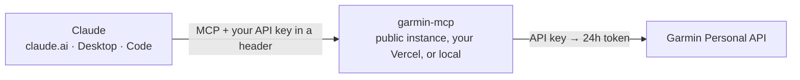

# garmin-mcp

**Talk to your Garmin data in Claude.** Sleep, HRV, Body Battery, stress, heart
rate, weight, workouts, and the FIT file of every activity, lap by lap, through
a read-only MCP server built on Garmin's official Personal API.


> [!WARNING]
> **This is an unofficial personal project.** It is not made, endorsed, or
> maintained by Garmin. "Garmin" and "Garmin Connect" are trademarks of Garmin
> Ltd. or its subsidiaries. The project only uses the
> [Personal API](https://developer.garmin.com/gc-developer-program/personal/personal-api)
> that Garmin opened in October 2026, with **your** key, to read **your** data:
> no scraping, no password. According to Garmin, this API is for individual use,
> not for apps that serve multiple people. Use at your own risk.

## What you can ask

- "How did I sleep this week compared with my monthly average?"
- "Break down Sunday's long run lap by lap. Did my pace drop at the end? Did my heart rate climb?"
- "Is my HRV below baseline? Cross-check it with stress and my last few workouts."
- "How many km did I run in October, and which workout was the hardest?"
- "What time of day does my Body Battery usually bottom out?"

## Real example: "look at today's workout"

With the connector on, that's all I asked on claude.ai. Claude called four tools
on its own:

| # | Tool | Why |
| --- | --- | --- |
| 1 | `garmin_list_activities` | Find the day's activity (summary only) |
| 2 | `garmin_get_heart_rate_zones` | Get the heart rate zones configured in Garmin |
| 3 | `garmin_get_activity` | Garmin's summary and **the training plan workout** being followed |
| 4 | `garmin_analyze_activity_file` | Open the original `.fit`: every lap and second-by-second data |

Putting it together, it compared what the plan asked for with what the watch
recorded:

> **Plan:** 6 km at a conversational pace. **Done:** 6.03 km at 5:58/km, average
> HR 162, almost half the time in zone 4, at 28–30 °C.
>
> | Km | Pace | HR | Power |
> | --- | --- | --- | --- |
> | 1 | 6:28 | 152 | 294 W (uphill) |
> | 2 | 5:49 | 159 | 279 W (downhill) |
> | 3 | 5:59 | 162 | 288 W |
> | 4 | 5:50 | 165 | 305 W |
> | 5 | 5:56 | 167 | 307 W |
> | 6 | 5:44 | 166 | 322 W |
>
> - It wasn't conversational: less than 1 minute in zones 1 and 2.
> - Power rose from 279 W to 322 W: you sped up without noticing.
> - Heart rate rose less than power, so there was no cardiac drift: your heart
>   tracked the effort, not fatigue.
> - Cadence and ground contact held steady to the end. The recorded perceived
>   effort (RPE) was 3 out of 10: it felt easy, but your heart worked much harder.
> - **Next long run:** run by heart rate, below ~145 bpm, even if your pace drops
>   on hot days.

All of it came from the data: the plan from `garmin_get_activity`, the zones
from `garmin_get_heart_rate_zones`, and per-lap power and cadence from the
`.fit`. Claude only did the math and the reading.

### Tips for asking

- **Say what the workout was meant to be** ("it was supposed to be easy", "it
  was 400 m repeats"). If the workout came from a Garmin plan, Claude finds the
  goal on its own through `garmin_get_activity`.
- **Ask for a lap-by-lap breakdown** to see pace, heart rate, and power for each
  km, or for each rep in an interval session.
- **Ask for comparisons** ("compare it with my long runs from last month").
  Claude searches activities by type, date, and distance.
- **Connect training and recovery** ("do my sleep and HRV this week explain that
  bad workout?"). It combines sleep, HRV, Body Battery, and stress for the same
  days.
- **Ask for more detail when you need it.** By default the tools return
  summaries to save context. You can ask for the full-day heart rate curve, more
  points from the `.fit`, or the GPS track.
- **Check your zones.** The analysis uses the zones configured in Garmin. If
  your max or resting heart rate is out of date there, the zone conclusions will
  be too.

## How it works



- You only provide your Garmin **API key**, valid for 30 days to 1 year. In
  remote mode it goes in the header of every request, and the server **stores
  no secrets**: without a valid key, nobody gets in.
- The server exchanges the key for a **~24h access token** and renews it on its
  own: before each call, if the token has less than 1h left, it gets a new one.
  If Garmin rejects the token early (401), it gets another and retries the call.
- What no code can renew is the key itself, because Garmin has no endpoint for
  that. When it expires, the tools tell you; create a new one (step 1) and swap
  it in the connector header.

## Pick where to use it

| Where | How it runs | Steps |
| --- | --- | --- |
| claude.ai, Claude Desktop, and Cowork | As a custom connector, on the public instance or your own Vercel | [1](#1-get-your-garmin-api-key) → [2](#2-use-it-as-a-custom-connector-on-claudeai) |
| Claude Code | On your computer, over stdio | [1](#1-get-your-garmin-api-key) → [3](#3-or-run-it-locally-claude-code-and-claude-desktop) |
| Claude Desktop (no hosting) | On your computer, over stdio | [1](#1-get-your-garmin-api-key) → [3](#3-or-run-it-locally-claude-code-and-claude-desktop) |

## 1. Get your Garmin API key

It's free, with no form and no approval: it takes a few seconds.

1. Sign in to **Garmin Connect in a browser** with your watch's account. The
   option lives in the web version's settings.
2. Open the Personal API page:
   <https://connect.garmin.com/app/settings/personalApiToken>
3. Create a key and pick how long it's valid: 30, 90, or 180 days, or 1 year.
   **Pick 1 year:** it can't be renewed from code, so the longer it lasts, the
   less upkeep.
4. **Copy it right away.** Garmin shows the key **only once**. Keep it in a
   password manager.

To check that the key works (replace `YOUR_KEY`):

```bash
curl -s -o /dev/null -w "%{http_code}\n" -X POST https://personal.connectapi.garmin.com/personalapitoken-service/personal-api/personal-api-key/token -H "Authorization: ApiKey YOUR_KEY"
```

`200` means the key is fine; `401` means it's wrong or expired.

> [!IMPORTANT]
> Treat the key like a password. It gives access to your sleep, health,
> menstrual cycle, and the GPS of your workouts. Don't put it in a repository,
> a screenshot, or a chat.

## 2. Use it as a custom connector on claude.ai

As a connector, the server runs on the internet and Claude calls it from
Anthropic's infrastructure. Once set up, it works on claude.ai, Claude Desktop,
and Cowork.

**The server stores no secrets.** Your Garmin API key stays in the Claude
connector, which sends it in the `Authorization` header of every call. The
server uses the key to get a token from Garmin, keeps the token in memory only,
and renews it when needed. That's why one server can be shared: each key only
ever sees its own data.

### 2.1 Pick a server

**Option A: use the public instance (quickest).** No setup at all. Use this URL
in the next step:

```
https://garmin-mcp-delta.vercel.app/mcp
```

> [!NOTE]
> The public instance is run by the author of this repo, on a free Vercel plan,
> with no uptime guarantee. Your key passes through it on every request. It's
> kept in memory only and never stored or logged, but you're trusting a server
> you don't control. Vercel's request logs record each call's IP address and
> time. Garmin describes the Personal API as meant for individual use. If any of
> that bothers you, or you'll use the connector every day, pick option B.

**Option B: deploy your own copy to Vercel.** Same code, on your own account
(the free Hobby plan is enough), so your key only goes to a server you control.

[](https://vercel.com/new/clone?repository-url=https%3A%2F%2Fgithub.com%2Fricardoraposo%2Fgarmin-mcp&project-name=garmin-mcp&repository-name=garmin-mcp)

1. Click the button above. Vercel creates a copy of the repo in your GitHub.
2. Click **Deploy**. No environment variables needed. In about 30 seconds you
   get a URL like `https://garmin-mcp-xxxx.vercel.app`.
3. Check that it's up:

   ```bash
   curl https://YOUR-PROJECT.vercel.app/healthz
   ```

   It should reply `{"ok":true,"name":"garmin-mcp"}`. Your connector URL is
   that address with `/mcp` at the end.

<details>
<summary>Prefer the Vercel CLI?</summary>

Inside a clone of the repo:

```bash
npx vercel login
```

```bash
npx vercel deploy --prod
```

To deploy on every push to `main`:

```bash
npx vercel git connect
```

</details>

### 2.2 Add the connector in Claude

1. On [claude.ai](https://claude.ai), open **Customize › Connectors** and click
   **Add custom connector**.
2. Fill in:

   | Field | Value |
   | --- | --- |
   | Name | `Garmin` |
   | MCP server URL | `https://garmin-mcp-delta.vercel.app/mcp`, or your own deployment's URL ending in `/mcp` |
   | Authentication | **No sign-in** |

3. Open **Request headers** and add one header:

   | Field | Value |
   | --- | --- |
   | Header name | `authorization` (pick it from the list) |
   | Value | `ApiKey YOUR_GARMIN_API_KEY` |
   | Required | On |

   Claude sends the value exactly as you type it, so include the word `ApiKey`,
   a space, and the key from step 1. On a Mac, this copies the key without the
   trailing newline:

   ```bash
   tr -d '\n' < ~/.config/garmin/connect-personal-api-key | pbcopy
   ```

   Alternatively, pick the `x-api-key` header from the list and paste just the
   key, without `ApiKey` in front.
4. Click **Add**. In a chat, turn the connector on from the **+ › Connectors**
   menu and ask something like *"how did I sleep last night?"*.

> [!IMPORTANT]
> Once saved, claude.ai doesn't let you edit a connector's authentication or
> headers, and it never shows the value again. To fix the key or swap in a new
> one, **remove the connector and add it again**.

The Free plan allows one custom connector; paid plans allow several. According
to [Claude's documentation](https://claude.com/docs/connectors/custom/add-unlisted#authenticate-with-request-headers),
the **Request headers** section is still in beta and doesn't show up for every
account. If you don't see it, use local mode (step 3).

### Troubleshooting

| Symptom | Likely cause | What to do |
| --- | --- | --- |
| Claude says it couldn't connect | URL without `/mcp` at the end | Make sure the URL ends in `/mcp` |
| "Couldn't connect to the server" | The header never arrived: it was missing, left optional and empty, or authentication isn't **No sign-in** | Remove the connector and add it again following step 2.2 |
| `401` "Send your Garmin Personal API key" | Header missing or without `ApiKey ` | Remove the connector and add it again |
| `401` "Garmin rejected this Personal API key" | Wrong, revoked, or expired key | Create a new one (step 1), then remove and re-add the connector |
| "Today" data empty late at night | Your Garmin profile has no time zone | Add an `X-Garmin-Timezone` header, e.g. `America/New_York` |

A key that Garmin rejects is blocked on the server for 5 minutes; after fixing
it, wait that long (or redeploy, if it's your own server).

### Security

- The key exists in only two places: the Claude connector and, during requests,
  the server's memory. It never goes to an environment variable, disk, or log.
- Garmin decides who gets in: the server exchanges the key for a token before
  anything else, and an invalid key gets a 401.
- Each key sees only its own data. Anyone using the same server, the public
  instance or yours, can only use it with **their** key, reading **their** data.
- The server is read-only: the Personal API has no write endpoints.
- Remote mode has no download tool, so nothing is saved on the server's disk.

## 3. Or run it locally: Claude Code and Claude Desktop

Requires Node.js 22.18 or newer.

```bash
git clone https://github.com/ricardoraposo/garmin-mcp.git && cd garmin-mcp && npm install && npm run build
```

Store the key in a file only you can read (copy the key first; `pbpaste` pastes
the clipboard):

```bash
mkdir -p ~/.config/garmin && pbpaste > ~/.config/garmin/connect-personal-api-key && chmod 600 ~/.config/garmin/connect-personal-api-key
```

The server looks for the key in this order: the `GARMIN_PERSONAL_API_KEY`
environment variable, the file named by `GARMIN_PERSONAL_API_KEY_FILE`, and
finally `~/.config/garmin/connect-personal-api-key`.

**Claude Code:**

```bash
claude mcp add garmin --scope user -- node /path/to/garmin-mcp/dist/index.js
```

**Claude Desktop:** in `~/Library/Application Support/Claude/claude_desktop_config.json`,
then restart the app:

```json
{
  "mcpServers": {
    "garmin": {
      "command": "node",
      "args": ["/path/to/garmin-mcp/dist/index.js"]
    }
  }
}
```

Local mode adds one more tool, `garmin_download_activity_file`, which saves the
original `.fit` to your computer.

## Tools

| Tool | What it returns |
| --- | --- |
| `garmin_get_profile` | Units, time zone, language, and training days |
| `garmin_get_heart_rate_zones` | Heart rate zones per sport and the method used |
| `garmin_get_daily_summary` | Everything for one day: steps, calories, resting HR, stress, Body Battery, SpO2 |
| `garmin_get_daily_summaries` | The same over a date range, filterable by `sections` |
| `garmin_get_sleep` | One night or several: stages, score, SpO2, respiration, sleep HR and stress |
| `garmin_get_hrv` | Overnight HRV, baseline, status, and optional 5-minute readings |
| `garmin_get_body_battery` | Charge and drain, events, and the optional daily curve |
| `garmin_get_stress` | Daily stress |
| `garmin_get_steps` | Daily steps and goal |
| `garmin_get_heart_rate` | Resting, min, and max HR, and the optional daily curve |
| `garmin_get_spo2` | Pulse ox and altitude acclimation |
| `garmin_get_hydration` | Water intake, goal, and sweat loss |
| `garmin_get_weight` | Weigh-ins, body composition, and goals |
| `garmin_get_nutrition` | The day's food log |
| `garmin_get_fitness_age` | Fitness age and what drives it |
| `garmin_get_menstrual_cycle` | Cycle summary or a single day's details |
| `garmin_get_wellness_activities` | Wellness activities |
| `garmin_list_activities` | Search workouts by type, date, distance, duration, or text |
| `garmin_get_activity` | A workout's full summary and the structured workout it followed |
| `garmin_analyze_activity_file` | Decodes the original FIT: session, laps, workout steps, and second-by-second data |
| `garmin_download_activity_file` | Saves the ZIP and the `.fit` to a folder (local mode only) |
| `garmin_api_get` | Raw GET on any Personal API endpoint |

<details>
<summary>Implementation details</summary>

- **Long ranges become several requests.** Garmin caps each call (steps and
  stress: 28 days; sleep, Body Battery, and hydration: 31; daily summaries: 1
  year). The tools split the range, fetch the chunks in sequence, and merge the
  result. The limits live in `MAX_DAYS`, in `src/tools.ts`.
- **Lean responses.** `null` fields are dropped, full-day series (HR every 2
  min, Body Battery, SpO2, HRV readings) only come back when you ask for
  `samples > 0`, and the activity list uses a `compact` summary by default.
- **Output cap.** If the JSON goes over ~90k characters (≈25k tokens), the
  largest array is trimmed and the response says how many items came back and
  how to get the rest. Tune it with `GARMIN_MCP_MAX_RESPONSE_CHARS`.
- **Columnar FIT stream** (`elapsed_s`, `heart_rate_bpm`, `speed_mps`,
  `power_w`…), much cheaper in tokens than one object per point. GPS only comes
  with `include_gps: true`. Running cadence in FIT is per foot: multiply by 2.
- **Token cache** compatible with Garmin's official Python client
  (`gc-personal`), at `~/.config/garmin/connect-personal-api-bearer-token.json`.
- **Time zone.** Cloud servers run in UTC; in HTTP mode, "today" and "last
  night" follow the time zone in your Garmin profile. The `X-Garmin-Timezone`
  header or the `GARMIN_TIMEZONE` environment variable are the fallbacks.
- **One session per key.** In HTTP mode, each key has its own 24h token in
  memory (up to 100 keys per instance).
- **Header format.** The default is `Authorization: ApiKey <key>`. The server
  avoids `Bearer` on purpose: in MCP, a 401 with a `Bearer` challenge makes the
  client look for OAuth, which this server doesn't have, and the key isn't an
  access token. It also accepts `Bearer <key>` (older setups) and the
  `x-api-key` and `X-Garmin-Api-Key` headers. On claude.ai only `x-api-key`
  works as an alternative, because header names outside the standard list need
  Anthropic's approval.
- **Stateless HTTP.** Each request creates a fresh MCP server and replies with
  JSON, with no session or stream: that's what works well on serverless.
- **Safe path in `garmin_api_get`.** It only accepts plain paths starting with
  `/`, so the token never goes to another host.

</details>

## What the Personal API doesn't have

There are 26 endpoints, all read-only, documented in
[Garmin's Swagger](https://developer.garmin.com/gc-developer-program/personal/swagger-docs/).
Left out: training readiness, training status, VO2 max trends, race
predictions, gear, devices, courses, workouts, and the calendar. You also can't
send a workout to the watch: that requires the Training and Courses APIs from
the business program.

## Development

```bash
npm test
```

Offline tests: dates and time zones, formatting, token cache, retry on 401,
path blocking, key in the header (including a rejected key), and a synthetic FIT
file built with the official encoder.

```bash
GARMIN_PERSONAL_API_KEY=YOUR_KEY node scripts/smoke.ts
```

Starts the server over stdio like a real MCP client and calls each tool once
against the real API. Pass tool names as arguments to run only some of them.

```bash
MCP_URL=https://YOUR-PROJECT.vercel.app/mcp GARMIN_PERSONAL_API_KEY=YOUR_KEY node scripts/smoke.ts
```

The same test against a running HTTP server, sending the key in the header.

```bash
GARMIN_PERSONAL_API_KEY=YOUR_KEY node scripts/call.ts garmin_get_sleep '{"start_date":"2026-10-01"}'
```

Calls one tool and prints the full response.

```bash
node dist/index.js --http --port 8787
```

Runs HTTP mode locally, or on any VPS or container (use `--host 0.0.0.0`).
`npm run dev` runs straight from TypeScript, without a build.

| Variable | Default |
| --- | --- |
| `GARMIN_PERSONAL_API_KEY` | (none) |
| `GARMIN_PERSONAL_API_KEY_FILE` | `~/.config/garmin/connect-personal-api-key` |
| `GARMIN_PERSONAL_API_TOKEN_CACHE` | `~/.config/garmin/connect-personal-api-bearer-token.json` |
| `GARMIN_PERSONAL_API_BASE_URL` | `https://personal.connectapi.garmin.com` |
| `GARMIN_MCP_MAX_RESPONSE_CHARS` | `90000` |
| `GARMIN_TIMEZONE` | Used in `--http` mode when the Garmin profile has no time zone |
| `PORT` / `HOST` | `8787` / `127.0.0.1` (`--http` mode) |

## References

- [Personal API overview](https://developer.garmin.com/gc-developer-program/personal/personal-api)
  and [Swagger](https://developer.garmin.com/gc-developer-program/personal/swagger-docs/)
- [Garmin's official Python client](https://github.com/garmin/connect-personal-api-python)
- [FIT JavaScript SDK](https://github.com/garmin/fit-javascript-sdk)
- [Custom connectors in Claude](https://claude.com/docs/connectors/custom/add-unlisted)
- [Model Context Protocol](https://modelcontextprotocol.io)
